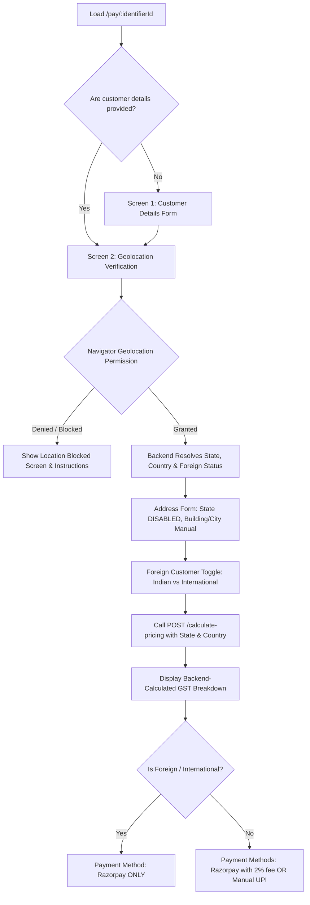

# Stage 4: Checkout MFE (Next.js :3001)

## 1. Directory Structure & Component Layering

```
apps/checkout-mfe/
├── app/
│   ├── layout.tsx                    # Root layout with solid golden theme provider
│   └── pay/
│       └── [identifierId]/
│           ├── page.tsx              # (< 100 lines) Checkout controller page
│           └── components/           # Route-level local components
│               ├── LocationBlocked.tsx # Blocking screen if navigator location denied
│               ├── CustomerPrefillForm.tsx # Step 1: Name & phone if not prefilled
│               ├── ForeignToggleBadge.tsx  # Nationality badge & foreign customer toggle
│               ├── AddressForm.tsx   # Step 2: Building/City (State disabled)
│               ├── DynamicPricingSummary.tsx # Backend-calculated tax & pricing card
│               ├── PaymentMethodSelector.tsx # Step 3: Razorpay vs Manual UPI (Razorpay only if foreign)
│               ├── RazorpayOptionCard.tsx    # Razorpay 2% fee breakdown & button
│               ├── ManualUpiCard.tsx         # UPI ID, QR code & "Done" action
│               └── PaymentStatusScreen.tsx   # Success/Pending status screen
├── components/
│   ├── ui/                           # Global shadcn design system UI kit (no portaling)
│   │   ├── button.tsx
│   │   ├── input.tsx
│   │   ├── card.tsx
│   │   ├── badge.tsx
│   │   └── alert.tsx
│   └── icons/                        # Solid monochrome iconpack
├── context/
│   ├── CheckoutContext.tsx           # Order details, backend pricing, active step
│   └── GeolocationContext.tsx        # Coordinates, permission status, resolved state & country
└── hooks/
    ├── useCheckoutSession.ts         # Loads order by identifierId & calls pricing API
    └── useGeolocationState.ts        # Navigator API watcher & backend state resolver
```

## 2. Multi-Step Flow & Foreign Customer Handling



## 3. Strict Rules Enforcement
- `page.tsx` line count < 100 lines.
- Indian State field: disabled attribute strictly enforced (`disabled={true}`).
- Initial pricing and all tax calculations fetched dynamically from backend API after state/country resolved.
- Foreign customer toggle: adjusts taxes to 0% (zero-rated export) and restricts payment methods strictly to Razorpay.
- No portaling: all UI cards and alerts rendered within standard DOM flow.
- Solid golden & orangish colors: `#D97706`, `#F59E0B`, `#EA580C`.
- Zero gradients, zero emojis, zero duotone icons.
- Zero comments in all code files.
